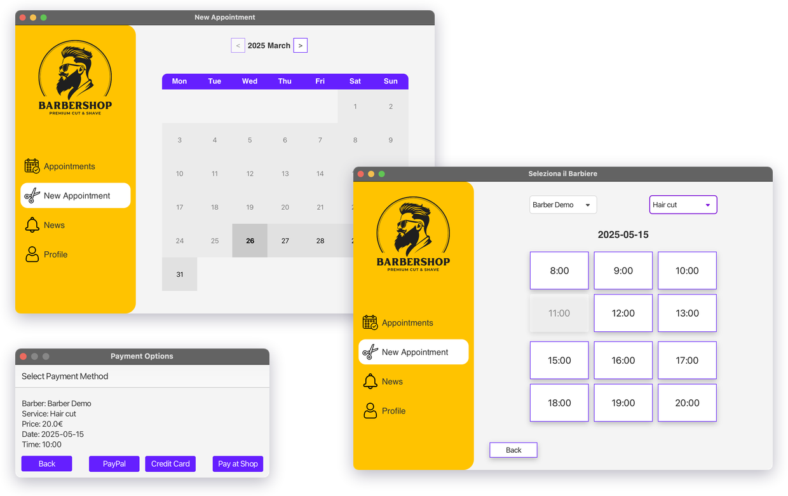
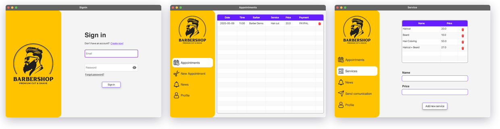
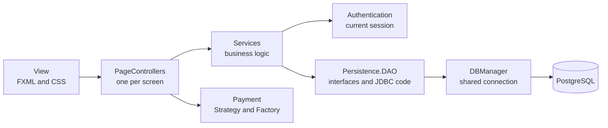
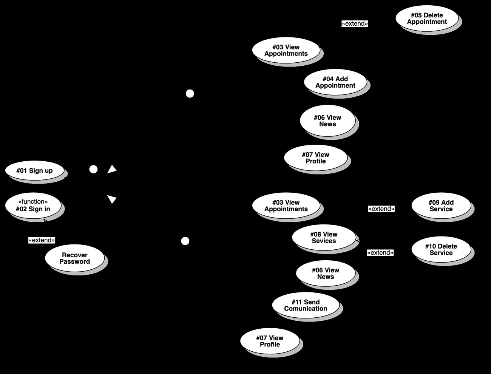
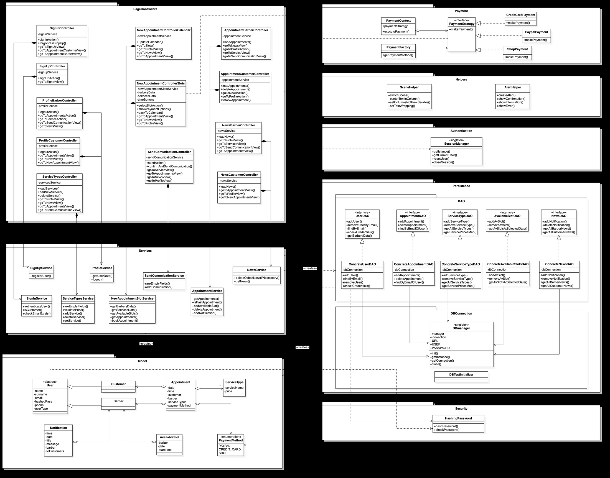

# BarberShop

A desktop application for booking and managing appointments at a barber shop.
Customers pick a date, a barber, one or two services and a free time slot, then choose
how to pay. Barbers see their appointments, manage the services on offer and send
communications to their customers.

<p align="center">
  
</p>

This was a team project for the Software Engineering course at the University of
Florence. It goes from requirements and UML design to a layered Java application with
a PostgreSQL database and 163 automated tests.

**Methods:** UML modeling (use case, class and navigation diagrams) · MVC with a
service layer · DAO, Singleton, Strategy and Factory patterns · unit, integration and
functional testing

**Tools:** Java 23 · JavaFX · MaterialFX · PostgreSQL · JDBC · jBCrypt · Maven ·
JUnit 5 · Mockito · TestFX · JaCoCo · Scene Builder · StarUML

## What it does

**Customers** can:

- book an appointment by date, barber, one or two services and free slot, choosing
  PayPal, credit card or payment at the shop
- see their appointments and cancel the upcoming ones
- read the barbers' communications and the notices about slots that have become free

**Barbers** can:

- see the appointments booked with them, and get a notice for each new booking
- add and remove services, with their prices
- send a communication to all customers

Both can see their profile and log out. A secret code entered at sign-up separates
barbers from customers.



When a barber registers, a database trigger creates their slots for the next year: 12
per day, from 08:00 to 13:00 and from 15:00 to 20:00. Booking removes a slot. Cancelling
puts it back and tells customers that it is free.

## Architecture



The 12 screens each have an FXML view and a controller. Controllers delegate to 8
services, and only the services reach the DAOs, so the interface never runs SQL. The
domain classes are in `Model`, and passwords are hashed with jBCrypt.

| Pattern | Where | Why |
|---|---|---|
| MVC | `View`, `PageControllers`, `Model` | Keeps the interface apart from the logic |
| DAO | `Persistence/DAO` | Services depend on interfaces, which can be mocked in tests |
| Singleton | `SessionManager`, `DBManager` | One current user and one database connection |
| Strategy and Factory | `Payment` | A new payment method does not change the booking code |

<details>
<summary>UML diagrams</summary>

**Use cases**



**Classes**



</details>

Requirements, mockups, the database design and all the diagrams are in the
[final report](Report.pdf), written in Italian.

## Testing

| Level | Tests | What runs |
|---|---|---|
| Unit | 78 | Services with mocked DAOs (Mockito), plus payments, hashing and the session |
| Integration | 14 | Services with the real DAOs, on a real database |
| Functional | 71 | The JavaFX screens, driven by a robot (TestFX) |

The final report measures **96% of instructions and 79% of branches** with JaCoCo.

## Limits

This is a course project, not a production system:

- Payments are simulated: each method only returns a message.
- The password recovery dialog shows a confirmation, but no email is sent.
- The database credentials and the barber secret code are hard-coded, so they are only
  suitable for local use.

## Repository structure

```
├── src/main/java/
│   ├── PageControllers/    # one JavaFX controller per screen
│   ├── Services/           # business logic
│   ├── Persistence/        # DAO interfaces, JDBC code and DBManager
│   ├── Payment/            # payment methods (Strategy and Factory)
│   ├── Authentication/     # current user session
│   ├── Security/           # password hashing
│   ├── Model/              # domain classes
│   └── Helpers/            # alerts and scene switching
├── src/main/resources/     # FXML views, styles and images
├── src/test/java/
│   ├── Unit/
│   ├── IntegrationTests/
│   └── Functional/
├── docs/
│   ├── schema.sql          # tables and the trigger that creates the slots
│   └── images/             # images used in this README
├── Report.pdf              # final report, in Italian
└── pom.xml
```

## How to run

You need Java 23, Maven and PostgreSQL. Create the role and the database, as a
PostgreSQL superuser:

```sql
CREATE ROLE "SWEuser" LOGIN PASSWORD 'swepass';
CREATE DATABASE "BarberShop_DB" OWNER "SWEuser";
```

Then load the schema and start the app:

```bash
psql -h localhost -U SWEuser -d BarberShop_DB -f docs/schema.sql
mvn javafx:run
```

The database starts empty. To try a booking:

1. Sign up as a barber, with the secret code `I-AM-A-BARBER`, and add a service.
2. Sign up as a customer, leaving the code empty, and book an appointment.

### Running the tests

> [!WARNING]
> The tests delete rows from the database they run on. Without the property below, that
> is `BarberShop_DB`, so always point them to a separate database.

Create a second database with the same schema, then run:

```bash
mvn verify -Dbarbershop.db.url=jdbc:postgresql://localhost:5432/BarberShop_test
```

The functional tests open real windows and move the mouse while they run. The coverage
report is in `target/jacoco-report/index.html`.

## Credits

Team project by Andrea Ferritti, Filippo Sansavini and Jieke Lin for the Software
Engineering course (Prof. Enrico Vicario), University of Florence, academic year
2024/25.
